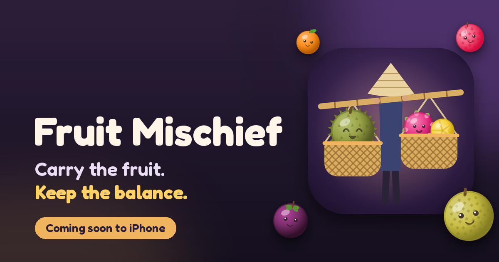

# Fruit Mischief: feedback, support, and the website

<p align="center"></p>

This is the public home of **Fruit Mischief**, a balance puzzle for iPhone: two baskets of tropical fruit on a street vendor's bamboo pole, a pole that tips toward the heavier side, and blessings that change every run. Open an issue to report a bug, suggest a blessing, or ask a question. Every issue gets read.

[**Report a bug →**](https://github.com/nguyenvanlamm/dropfruitesweb/issues/new?template=bug_report.yml) · [**Suggest an idea →**](https://github.com/nguyenvanlamm/dropfruitesweb/issues/new?template=feature_request.yml) · [**General feedback →**](https://github.com/nguyenvanlamm/dropfruitesweb/issues/new?template=feedback.yml) · [**Email**](mailto:lamnv260398@gmail.com)

> **Coming soon to the App Store.** Click **Watch → Custom → Releases** at the top of this page to get the App Store link the day it goes live.
> Website: [fruit-mischief.lamnv.com](https://fruit-mischief.lamnv.com/)

## Reporting a bug

| Include | Example |
|---|---|
| iPhone model and iOS version | iPhone 15, iOS 26.0 |
| App version | Settings → Apps → Fruit Mischief |
| What happened | Two lychees in the same basket touched but didn't merge |
| What you did just before | Held Magnet, used Cleaver on a Guava |

A screenshot or short screen recording helps a lot. [Search open issues](https://github.com/nguyenvanlamm/dropfruitesweb/issues) first. If yours is already there, add a 👍 or a comment.

---

<details>
<summary>Website development (this repo)</summary>

A static site with no framework and no runtime dependencies. `scripts/build.mjs` wraps each page in `src/pages/` with `src/layout.html` and copies `src/static/` into `dist/`.

```bash
npm run build     # src/ → dist/ (pages, sitemap.xml, robots.txt, .nojekyll)
npm run check     # every local href/src and #anchor in dist/ resolves
npm run serve     # preview at http://localhost:4173/ (same base path as the live site)
npm test          # build + check
```

Requires Node 20+. Nothing to install.

| Path | What it is |
|---|---|
| `src/layout.html` | Shared `<head>`, header, and footer |
| `src/pages/*.html` | Page bodies, each with a `<!--meta {json} -->` header (title, description, path) |
| `scripts/content.mjs` | Fruit ladder, blessings, FAQ, inline icons |
| `src/static/assets/img/board.webp` | The hero screenshot, rendered by the game |
| `src/static/assets/fruits/` | The 11 fruit, rendered from the game's art (`lib/ui/fruit_art.dart`) |
| `scripts/og-image.py` | Regenerates `og-image.png` from the game art (needs Pillow) |

Fruit radii, scores, and blessing numbers mirror the game's engine tables. Update `scripts/content.mjs` when they change.

### Deploying

Every push to `main` runs [`.github/workflows/deploy-pages.yml`](.github/workflows/deploy-pages.yml): build → link check → deploy `dist/` to GitHub Pages. Pull requests run build and check only.

One-time setup: **Settings → Pages → Build and deployment → Source: GitHub Actions**.

For a custom domain, add `src/static/CNAME`, then build with `SITE_URL=https://your.domain BASE_PATH=/` (in the workflow's build step).

### Launch day

When the App Store listing is live, replace the "Coming soon" badge and the **Get Notified** buttons in `src/pages/index.html` with the App Store link, and move the 1.0.0 changelog entry from *Upcoming* to its release date.

</details>

## Credits

Fruit, vendor, pole and baskets: original art drawn for the game. Blessing icons: Lorc and Delapouite, [game-icons.net](https://game-icons.net) (CC BY 3.0). Font: [Fredoka](https://fonts.google.com/specimen/Fredoka) (OFL 1.1). The full table is on the [credits page](https://fruit-mischief.lamnv.com/credits.html).

© Fruit Mischief. All rights reserved. Third-party assets remain under their own licenses.
